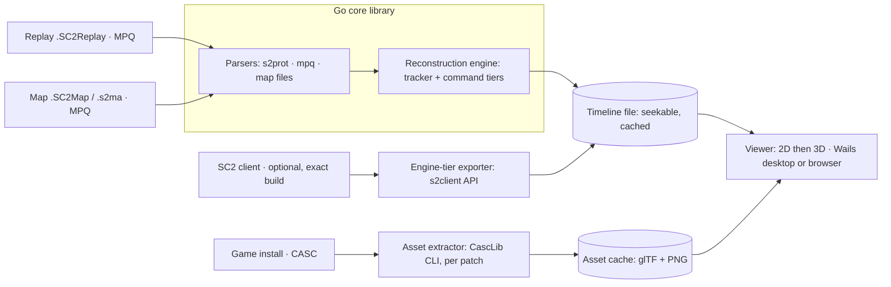

# SC2 Replay Viewer — Project Plan

Oct 23, 2026

## Overview

Build an open-source viewer that plays back a `.SC2Replay` on the real map terrain with real unit and building models, without running the StarCraft II engine. The core is a Go library built on [s2prot](https://github.com/icza/s2prot) that turns a replay plus its map into a normalized, seekable game timeline; a renderer then draws that timeline.

**Goals**

- Open any replay, auto-locate its map, and show terrain, resources, start locations and buildings.
- Play, pause, scrub and change speed, with a minimap, player panels (supply, income, army value) and an event feed.
- Render units with their actual models, using assets extracted locally from the user's own SC2 install.
- Keep the timeline format renderer-agnostic so a 2D web viewer, a 3D viewer and analysis tools all share it.

**Non-goals (v1):** editing replays, live game spectating, ladder stats, and shipping any Blizzard assets.

## The core problem: replays store inputs, not positions

An SC2 replay is a lockstep input log: the real client re-simulates the whole game from player commands. It never records where each unit is on each frame, so a standalone viewer must reconstruct movement. This single fact drives the architecture.

| Stream (file in the replay MPQ) | What it gives us | Limits |
| --- | --- | --- |
| `replay.tracker.events` | Unit born/init/done/died with type, owner and x,y; type changes (morphs); upgrades; player stats every 160 loops; periodic unit position samples | Only present from patch 2.0.8 on. Position samples are sparse and coarse, and (verify) only cover units that recently dealt or took damage, so mining workers and travelling units are often never sampled |
| `replay.game.events` | Commands (ability + target point or target unit), selection deltas, control groups, camera moves | Orders apply to the current selection, which we must track ourselves |
| `replay.details` / `replay.initData` | Players, races, colors, result, map title, map cache handle | — |
| `replay.message.events` | Chat, pings | — |

So the viewer offers three fidelity tiers that all emit the same timeline:

1. **Tracker tier** — exact building placement, unit spawn/death, and unit motion interpolated between position samples. Fast, needs nothing but the replay and map. Ships first. Because samples mostly exist for units in combat, motion outside fights is largely missing at this tier: expect correct builds, deaths and fight locations, not correct movement.
2. **Command tier** — adds selection tracking and replays move/attack/patrol orders over a pathing grid, then snaps to each tracker sample to correct drift. Visibly better motion, still approximate in fights.
3. **Engine tier** — drives an installed SC2 client of the matching build through Blizzard's API in replay mode and dumps exact unit state every N loops. Frame-accurate, but needs the game and the right version.

## Data sources

Three inputs, three different containers. One correction to the starting assumption: modern SC2 installs keep unit and building data in Blizzard's **CASC** storage, not MPQ. Replays and maps are still MPQ archives.

| Input | Container | Reader | What we extract |
| --- | --- | --- | --- |
| Replay (`.SC2Replay`) | MPQ | `icza/mpq` + `s2prot/rep` | Header (build, loops), details, init data, game/tracker/message events |
| Map (`.SC2Map` / cached `.s2ma`) | MPQ | `icza/mpq` + custom parsers | `MapInfo` (size, playable bounds), `t3HeightMap`, `t3CellFlags` / pathing, `t3Terrain.xml` + texture masks, `Objects` (minerals, geysers, rocks, doodads), `Minimap.tga` |
| Game data and art | CASC (local install) | CascLib, via a small extractor CLI | XML catalogs (`UnitData`, `ActorData`, `ModelData`, footprints), `.m3` models + animations, `.dds` textures, terrain tile sets, unit icons |

**Finding the map.** The replay's details and init data hold cache handles (extension, region, content hash). The list also includes dependency mods, so the map's handle has to be picked out of it. Look it up in the local Battle.net cache first; the cache is split into subfolders by hash prefix (`Cache/ab/cd/abcd….s2ma`), under `C:\ProgramData\Blizzard Entertainment\Battle.net\Cache` on Windows and `/Users/Shared/Blizzard/Battle.net/Cache` on macOS (verify). If missing, fetch `<hash>.s2ma` from Blizzard's regional depot server (`http://<region>.depot.battle.net:1119/`) and cache it. A file-picker fallback covers custom or offline maps.

**Map archives.** Published ladder maps are locked: their MPQ has no file list, so files must be opened by known name. Confirm early that `icza/mpq` handles every compression type these maps use.

**Version matching.** Unit stats, radii and even unit IDs change between patches. Key all game-data lookups on the replay's base build, and keep a small per-build table for unit type IDs (the tracker events carry type names as strings, which helps). The tracker and command tiers need tracker events, so the minimum supported build for timelines is 2.0.8; older replays get `info` only.

**Coordinates and time.** Game loops run 16 per game second (22.4 per real second on Faster). Since Legacy of the Void the in-game clock shows real seconds, so every user-facing time is loops ÷ 22.4; 16 loops per game second is only for internal math. Tracker x,y are map cells; command targets are fixed-point and need scaling; unit tags are packed as index plus recycle counter and must be decoded the same way in both streams so orders can be matched to units. No stream records facing; it is derived from movement direction.

## Architecture and stack

A Go core does all parsing and reconstruction, because s2prot and its MPQ reader are Go. Everything downstream reads one timeline file, so the engine tier and any future viewer plug in without touching the renderer.

| Layer | Choice | Why |
| --- | --- | --- |
| Core library + CLI | Go: `s2prot`, `icza/mpq`, own map parsers | Native fit with s2prot; one static binary |
| Timeline format | Protobuf (or FlatBuffers for zero-copy seeks) | Language-neutral, versioned schema |
| Asset extractor | C++ CLI on CascLib, outputs glTF + PNG | Keeps the native CASC dependency out of the core. *Built instead as a pure-Go CASC reader inside the core, converting on demand; see docs/DECISIONS.md, Phase 3.* |
| Viewer | TypeScript + three.js (2D via orthographic camera) | One renderer for 2D and 3D; runs in a browser |
| Desktop shell | Wails (Go backend + web frontend) | Reuses the Go core directly; no Electron |
| Web build | Go core compiled to WASM | Drag-and-drop replays with no install, assets permitting |
| Engine exporter | Python on `pysc2`/s2client, or Go over the protobuf API | Optional, separate tool |

## State reconstruction engine

The engine turns raw events into a timeline any frontend can seek in constant time. It runs once per replay and caches its output next to the replay hash.

**Timeline format** (protobuf or FlatBuffers, one file per replay):

- `units`: tag, type, owner, born/done/died loops, morph history.
- `tracks`: per-unit keyframes `(loop, x, y, facing, state)`, tagged by source (tracker sample, command estimate, engine exact). Positions at any loop come from a binary search on the unit's track.
- `snapshots`: alive-unit set and aggregate state every 160 loops (~7 s on the in-game clock), so seeking never replays events from zero.
- `events`: commands, deaths, upgrades, chat, player stats — for the feed and graphs.
- `meta`: build, map hash, players, fidelity tier used.

**Tracker tier steps**

1. Create each unit at its born/init position. Neutral units born at loop 0 (minerals, geysers, rocks) give exact resource positions (verify), which also cross-checks the map's `Objects` file.
2. Buildings are fixed from then on, except types that move: Terran buildings that lift off and land, and uprooted spine and spore crawlers. For those, take the new position from the land/root command's target point in `replay.game.events`, or from the next position sample.
3. Insert every position sample as a keyframe; mark morphs and deaths.
4. Fill gaps by plain straight-line interpolation (no pathing clamp: that waits for the command tier, which must also leave air units unclamped). Units with no samples stay put until their next known position, except workers, which are placed in a fixed spot near their nearest base until the command tier models mining.

**Command tier additions**

1. Track each player's selection and control groups from selection-delta and control-group events.
2. Map each command to its selected units; resolve smart-click on a target unit into move, attack, gather or follow.
3. Path toward targets with A* on the map's pathing grid, using per-type speed from the build's `UnitData`.
4. Model worker mining loops (base → mineral patch → base), which covers a large share of on-screen movement.
5. At every tracker sample, compare estimate to truth and blend the error out over a few frames.

**Engine tier.** A separate exporter uses Blizzard's SC2 API (`s2client-proto`) to start the replay in a matching game build, step N loops at a time, and write raw unit positions, health and orders into the same timeline file. The renderer does not know or care which tier produced the data.

**Testing.** Run the command tier against engine-tier output for the same replays and report mean position error per unit type. That gives a measurable target for each improvement.

## Rendering and UI

Start in 2D top-down, then add 3D on the same data. A 2D view is useful on day one and doesn't block on the hard `.m3` work.

**2D view (first)**

- Terrain: height map shaded into a hillshade, cliffs from cell flags, minimap image as a base layer.
- Units and buildings: footprint-sized shapes in player color, sized by radius. Phase 1 uses a type label and a small checked-in game-data table; unit icons and per-build sizes from CASC arrive with the Phase 3 extractor.
- Missing map: render units on a blank grid sized from the replay, with a prompt to pick the map file.
- Overlays: command target lines, death markers, creep spread (from tumor/hatchery births), camera position per player.

**3D view (later)**

- Terrain mesh from the height map, splatted with the tile-set textures and masks from the map.
- Doodads and resources from the map's `Objects` file.
- Units: `.m3` models converted once to glTF by the extractor, with idle/walk/attack/death animations driven by track state.
- Fog of war per player, computed from unit sight radii.

**Shared UI**

- Timeline scrubber with markers for battles (death clusters), expansions and upgrades.
- Player panels: supply, income, workers, army value from player-stats events.
- Event feed, chat, and a click-to-inspect unit panel.
- Speed control (0.5×–16×) and keyboard shortcuts matching the in-game replay viewer.

## Phased roadmap

Phase 1 is the first release people can use; each later phase improves it without blocking it. The engine tier comes before the command tier so every pathing change can be measured against ground truth.

| Phase | Scope | Exit gate |
| --- | --- | --- |
| 0 · Foundations | Go repo + CLI that dumps a replay to the timeline format via s2prot; map parser (MapInfo, height map, pathing, Objects); map-cache and depot lookup | `info` parses a corpus spanning every major patch; `dump-timeline` succeeds on every replay from 2.0.8 on |
| 1 · 2D viewer, tracker tier (MVP) | Top-down view: hillshaded terrain, buildings, labelled unit shapes, minimap; scrubber, speed, player panels, event feed; Wails desktop build | A full pro game renders at 60 fps (on-screen FPS readout); a Go benchmark shows any seek in under a second; seeking matches replay-from-zero. Motion outside fights is knowingly incomplete at this tier |
| 2 · Accuracy | Engine-tier exporter on the s2client API (ground truth); command tier: selection tracking, A* pathing, worker mining, error report vs ground truth | Command-tier position error meets the target set from benchmarks |
| 3 · 3D | CASC extractor; `.m3` → glTF with animations; terrain mesh + texture splatting; doodads, resources, fog of war; 2D/3D toggle | Every unit in the current ladder pool renders and animates |
| 4 · 1.0 release | WASM browser build, installers, user docs, contributor guide; plugin hooks (build orders, battle detection) | — |
| 5 · Depth, then ship | More analysis plugins (expansions, supply blocks, income/army/worker graphs); 3D terrain fidelity (texture-mask blending, creep); command-tier accuracy round 3 (unit blocking, fights, Medivac boost); publish 1.0 (real repository, CI, first release) | Every change to the command tier lowers measured error; the release workflow produces installable builds on all three OSes |

| 6 · Hardening and loose ends | Every item left open by Phases 0–5 (below): release verification and distribution, checks against a current full game install, command-tier round 4, 3D fidelity, analysis gaps | See each track |

No dates yet: sizing depends on team size and how much `.m3` work the community add-on saves.

### Phase 6: open items from earlier phases

Each item names the phase that left it open (details in [docs/DECISIONS.md](docs/DECISIONS.md)). The tracks are independent and can run in parallel; within a track, items are in suggested order.

**A. Release and distribution** — exit: a published release installs and opens a replay on Windows, macOS and Linux.

1. Get CI and the release workflow green on real runners, including the NSIS installer step, which has never run (Phase 4: NSIS couldn't be installed locally).
2. Install each artifact on a clean machine per OS, and check the `.SC2Replay` file association on Windows (Phase 4).
3. Open replays from Finder on macOS: handle Wails' file-open events after start-up, not only command-line files (Phase 4).
4. Linux packages: `.deb` and AppImage, and a build for WebKitGTK 4.1 (Ubuntu 24.04+) (Phase 4).
5. Code signing for Windows and notarization for macOS; needs maintainers' certificates (Phase 4).
6. Host the browser build (GitHub Pages) and shrink `ghostreel.wasm` (20.6 MB, mostly s2prot's protocol tables): load only the replay's protocol, or compress better (Phase 4).
7. Make the repository public once 1–2 are done; add screenshots made with Shaded terrain only (Phase 1 rule).

**B. Checks against a current full game install** — exit: every ladder unit type verified, and ground truth exists for current game versions and for Zerg players.

1. Run `ghostreel assets` against a current Windows/macOS install: the Archon (stripped from the Linux 4.10 package) and full-resolution textures, models and ground textures (Phase 3).
2. Record engine ground truth (`ghostreel-engine`) on current-version replays. The Linux client is 4.10 only, so this needs a Windows or macOS client (Phase 2).
3. Include games where the Zerg side is a player rather than the AI, so creep speed can finally be measured (Phase 2).
4. Re-check terrain heights against command target heights on those maps; Magannatha's 2-unit offset is believed to be a map-version mismatch (Phase 3).

**C. Command tier, round 4** — exit (as before): every change lowers the measured error; a change that doesn't is reverted and recorded.

1. Selection-tracking recall (85% of commands found): raw-API bots and control-group edge cases. Missed commands leave units parked (Phase 2/5).
2. Fights: kiting and chasing between attack-move stops (Phase 2).
3. Units blocking each other: crowds at ramps and in mineral lines (the Ultralove Siege Tank jam, mean 44.6 cells) (Phase 2/5).
4. Medivac boost: classified but not applied (Phase 2).
5. Players without orders (the built-in AI): army movement between observations. Worker mining was tried and reverted; the AI's own transfer and gather rules would need ground truth on AI behaviour first (Phase 5).

**D. 3D fidelity** — exit: a ladder map in 3D reads like the game at a glance, at 60 fps on a mid-range GPU.

1. A performance pass on a real GPU: so far it was measured only on a software renderer, 55 ms per frame with 96 models (Phase 3).
2. ~~Cliff meshes from the tile set's cliff models in place of the heightfield's walls (Phase 3/5).~~ Done 2026-10-27 (see DECISIONS).
3. Water, and creep that recedes after its source dies rather than vanishing (Phase 3/5).
4. Weapon and attachment models, per-actor scale, and lighting per tile set (Phase 3).
5. The minimap's handling of fog-hidden units: it may lag a frame; unverified (Phase 3).

**E. Analysis** — exit: the common questions about a game are answered in the panel.

1. APM and actions over time: keep a per-player count of commands in the timeline (Phase 5).
2. Production idle time, army composition over time, upgrade timings per player (Phase 5).
3. Supply blocks to the loop, rather than to the 10 s stats interval, by tracking supply from births and deaths (Phase 5).

**F. Health, shields and energy (engine tier)** — exit: an engine-tier replay shows each unit's health, shield and energy bars in 2D, 3D and exported video, matching the game's values at every recorded frame.

Replays record no hit points: tracker events give births, deaths and position samples, and game events only commands. The only source is the game itself, through `ghostreel-engine`, which already observes every unit every 16 loops and drops these values. So bars exist only for replays with an engine recording; other tiers show none, and the inspect panel says why.

Steps 1–4 done 2026-10-29 (see DECISIONS); no recording has vitals until step 5 runs.

1. **Record them.** Add `health`, `health_max`, `shield`, `shield_max`, `energy`, `energy_max` to `UnitSample` in `proto/engine/v1/engine.proto` (new fields, so older recordings still read, as "no vitals"), and fill them in `internal/engine/export.go` from the API's `Unit` (the 4.10 client has them). Measure the size: the five test recordings are 1–4.8 MB gzipped now; values that rarely change should compress well.
2. **Carry them in the timeline.** A per-unit vitals track beside the keyframes in `proto/timeline/v1/timeline.proto`: keys of loop, health, shield, energy, stored only when a value changes by more than 1% of its maximum or a maximum changes (upgrades, morphs), with the maxima on the key. `timeline.ApplyEngine` builds it; other tiers leave it empty. Document in `docs/TIMELINE_FORMAT.md`, keep old timelines readable, and bump `CacheVersion`.
3. **Draw them.** `Model.vitalsAt(unit, loop)` holds the last key (damage is discrete, so no interpolation). Bars in the game's style: shield (blue) over health (green to yellow to red) and a thin energy bar (purple), drawn on the labels canvas above each unit (screen-projected in 3D, like labels), so the video export gets them too. Shown for damaged units and the selected one by default, with a key to show all or none; none for units hidden by fog. The inspect panel shows the numbers.
4. **Tests.** Engine samples round-trip with vitals; `ApplyEngine` keeps a key per real change and drops the rest; `vitalsAt` holds and steps; Go and TypeScript agree on a fixture with vitals.
5. **Recordings.** Re-export the five test games on the sc2-headless VM (4.10 client) so the feature can be checked, under the VM's limits (one SC2 process, `nice 10`, pause above load 7). **Ask the VM's owner before this run.** For current-version games (your own ladder and bot games), `ghostreel-engine` would have to run on a Windows or macOS client of the same build; its launcher has a Windows branch that has never been tried (track B, item 2).

Steps 1–4 need no game client and can be built and tested on the existing recordings, which simply have no vitals; step 5 is what makes bars appear.

## Legal, licensing and risks

The code can be fully open source; Blizzard's art and data cannot be redistributed. The extractor reads the user's own install and writes a local cache, and the repo ships no models, textures, icons or map files. Avoid "StarCraft" in the project name and logo, and license the code Apache-2.0 to match s2prot.

| Risk | Impact | Mitigation |
| --- | --- | --- |
| `.m3` format complexity (multiple versions, bone animation) | 3D view slips | Ship 2D first; reuse community m3 format docs and the Blender m3 add-on as a reference |
| Tracker-tier motion is mostly missing outside fights | MVP looks static; users judge it on movement | Say so in the UI and docs; park workers near bases; command tier fixes it |
| Command-tier drift in big fights | Units visibly wrong | Snap to tracker samples; label the tier in the UI; offer engine tier |
| Locked ladder maps, unusual MPQ compression | Map parsing fails on some maps | Open files by known name; test `icza/mpq` on current ladder maps in Phase 0 |
| Browser build can't reach the depot (plain HTTP on port 1119, no CORS) | WASM build can't auto-fetch maps | Map file picker in the browser, or an optional fetch proxy. *Decided in Phase 4: the file picker (see docs/DECISIONS.md)* |
| Patch changes to unit data or protocol | Old or new replays break | Key all data on base build; s2prot already handles protocol versions |
| Map not in local cache, depot unreachable | Can't load terrain | Cache aggressively; fall back to a user-picked map; still render units on a blank grid |
| Engine tier needs exact game build | Hard to set up | Optional, documented separately; never required for normal use |
| CASC access from Go | Extra native dependency | Isolate CascLib in a standalone extractor CLI, run once per game patch |

## Prior art and references

Only s2prot was opened for this draft; the rest are well-known projects listed from memory and should be checked before relying on them. Before Phase 1, also search for existing 2D replay viewers to borrow from or avoid duplicating. Facts marked (verify) in this plan should be confirmed against a real replay or map in Phase 0.

| Project | Use here |
| --- | --- |
| [icza/s2prot](https://github.com/icza/s2prot) | Go replay decoder, Apache-2.0, all retail versions; high-level `rep` package |
| [icza/mpq](https://github.com/icza/mpq) | Go MPQ reader that s2prot pairs with; reuse for map files |
| [icza/scelight](https://github.com/icza/scelight) | Java replay analyzer by the same author; replay model and map handling to study |
| [Blizzard/s2protocol](https://github.com/Blizzard/s2protocol) | Official Python reference decoder and event docs |
| [Blizzard/s2client-proto](https://github.com/Blizzard/s2client-proto) | Game API for the engine tier |
| [deepmind/pysc2](https://github.com/deepmind/pysc2) | Proof that API-driven replay playback and rendering works |
| [ggtracker/sc2reader](https://github.com/ggtracker/sc2reader) | Python parser with mature selection tracking and map-cache lookup logic |
| [ladislav-zezula/CascLib](https://github.com/ladislav-zezula/CascLib) | C++ CASC reader for the asset extractor |
