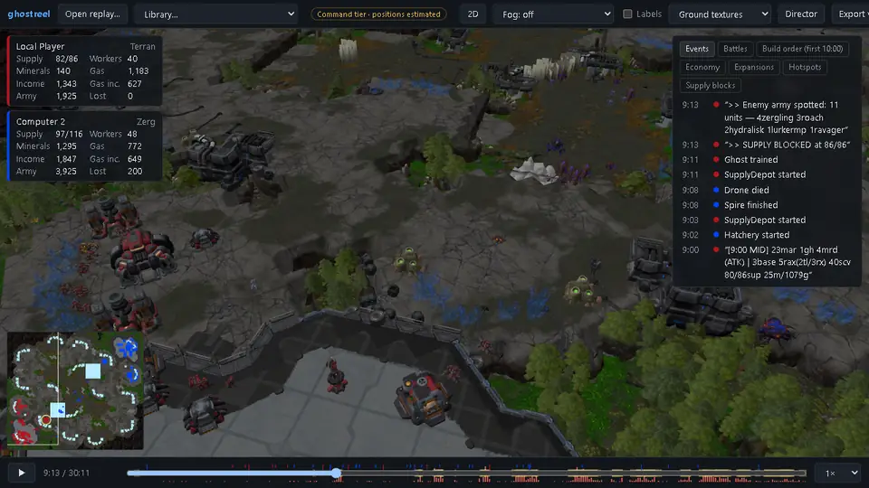
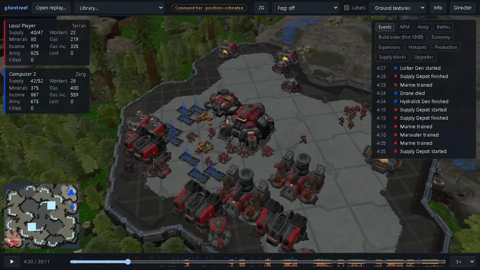
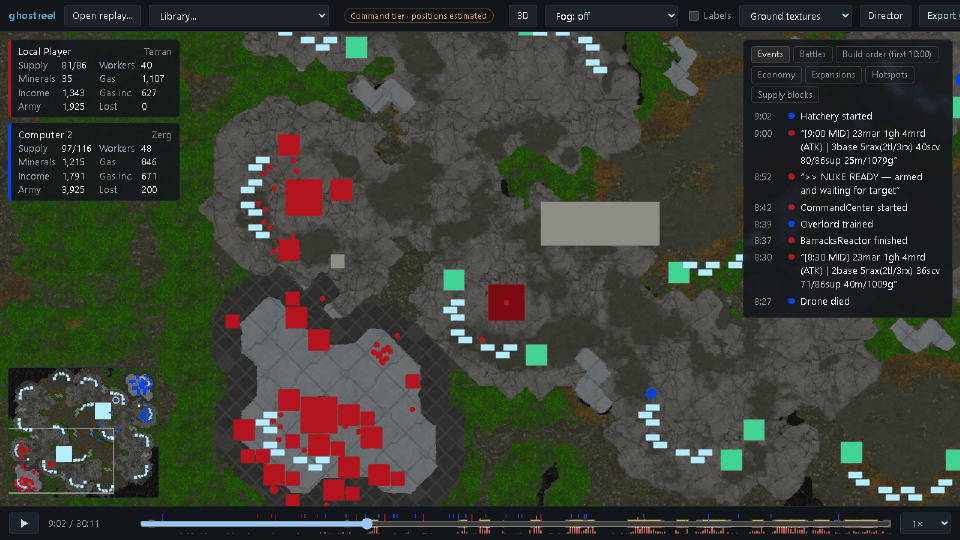
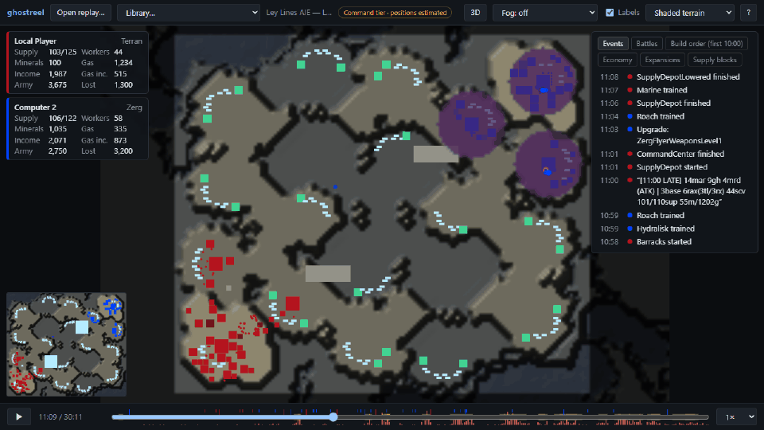
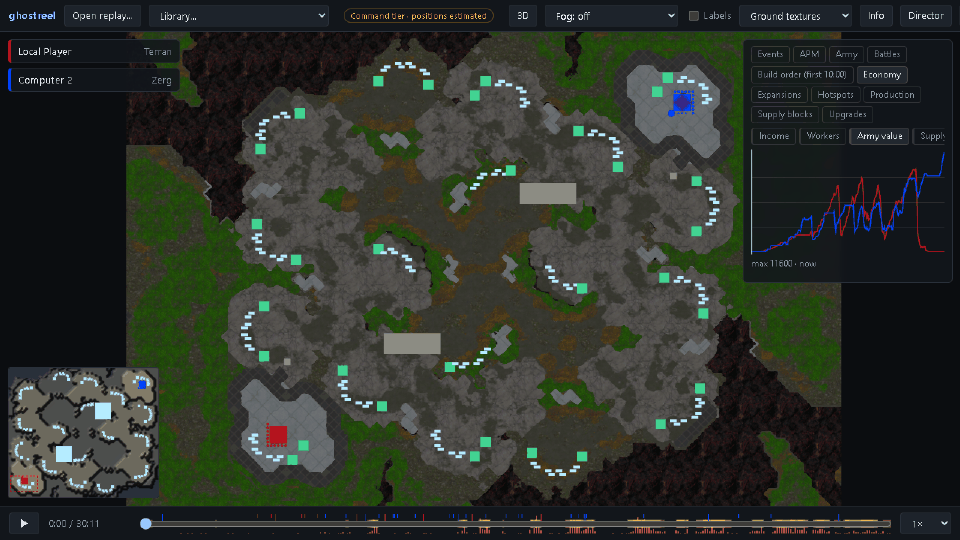
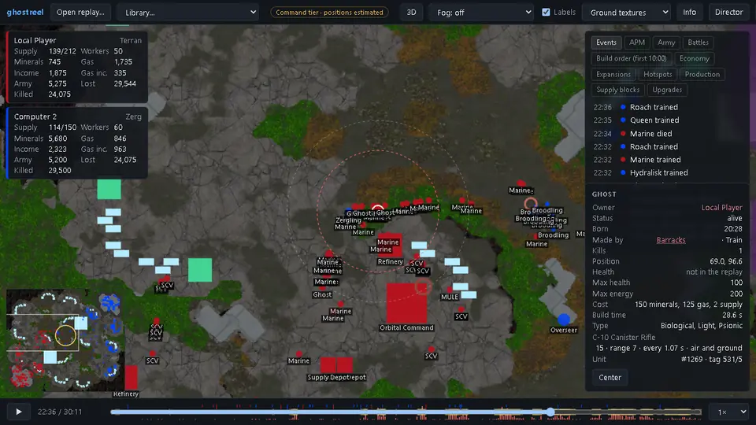
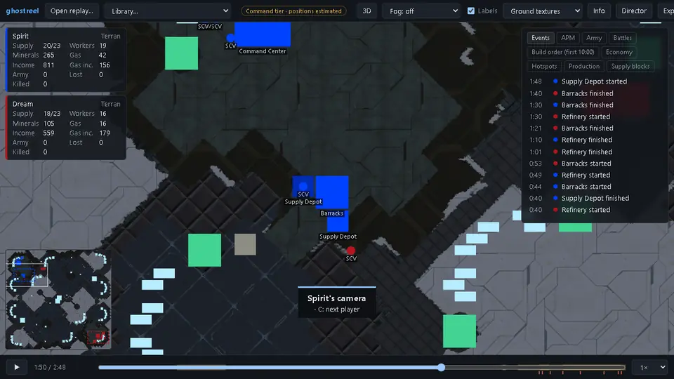
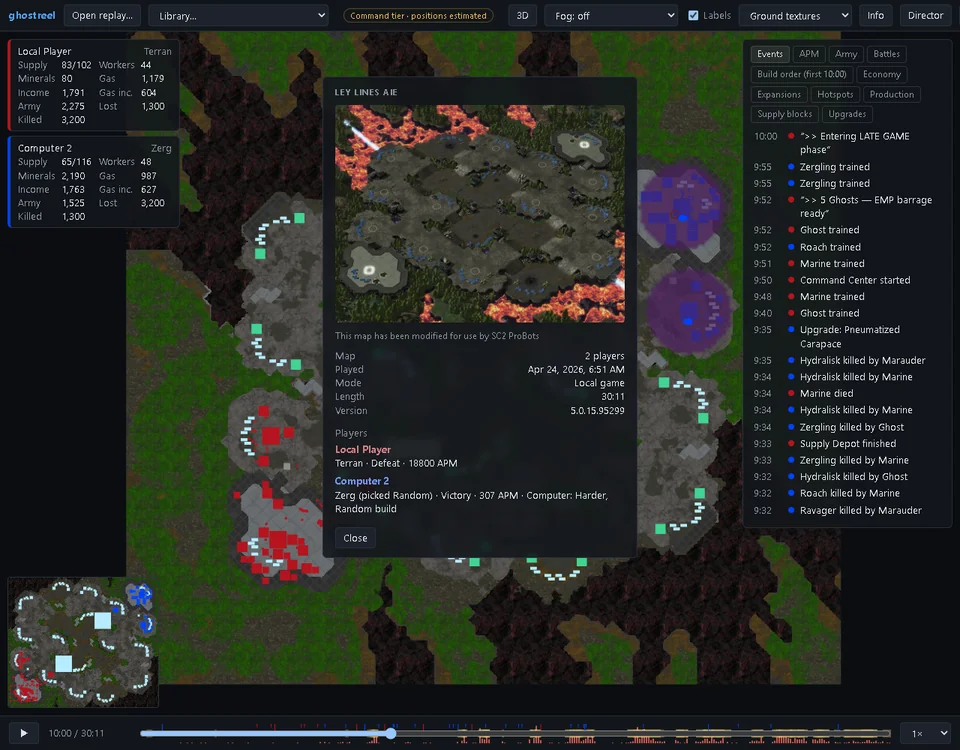

# ghostreel

An open-source StarCraft II replay viewer. It plays a `.SC2Replay` back on the map's terrain without running the game: buildings, units, deaths, supply and income, scrubbable to any moment. It also shows who killed what, each unit's stats, where each player was looking, and the game's details: when and where it was played, players' APM and MMR, and the map's own description and picture.

ghostreel is a working name. The project is not affiliated with or endorsed by Blizzard Entertainment.

> **What you're seeing.** A replay stores player inputs, not unit positions, so a viewer has to reconstruct movement. Births, deaths, buildings and player stats are always exact. How positions are filled in depends on the *tier* (the badge at the top of the viewer says which one you're seeing):
>
> - **Command tier** (the default): units follow the players' recorded orders along the map's paths: moves, attack-moves that stop at enemies, Stimpack, creep. Workers mine, new units walk to their rally point, and the estimate snaps to the real position whenever the replay sampled one. Measured against the real game, the commanded players' moving units are off by a median of about 2–2.6 cells (mean 2.6–6). Players with no recorded orders (the built-in AI) fall back to the tracker tier.
> - **Tracker tier:** positions are known only when the replay sampled them (every ~11 s, mostly in fights) and at death; in between, units hold their last known position. Median error on moving units is 5–22 cells.
> - **Engine tier:** exact positions, recorded by playing the replay in the real game with `ghostreel-engine` (see below).
>
> The inspect panel shows when a unit's position was last actually observed.

## Demo

A 30-minute Terran vs Zerg game on Ley Lines, recorded with StarCraft II installed: ghostreel draws the game's own models, doodads, cliffs and painted ground from the install, lit with the map's own lighting. Without one it uses shaded terrain and plain shapes.

**3D:** the Zerg army hits the Terran natural at 9:14, camera orbiting.



**A base at 4:30:** SCVs mining, buildings going up, Marines and Marauders gathering.



**Playback in 2D:** the same fight from above. Units follow their players' orders; deaths leave red rings, and the yellow ring on the minimap marks the battle.



**Fog of war:** everything, then what the Terran player could see, then the Zerg player.



**Analysis:** army value and income over the game, then the build order and the battles found.



**Unit stats and kill credit:** a selected Ghost at 22:36, with its stats from the game data, its weapon range drawn as rings, and its kill count going up. The feed says who killed what.



**Players' cameras:** a tournament game (Dream vs Spirit) following Spirit's camera, then Dream's. The minimap shows where each player was looking.



**Game details:** the map's title, description and picture, when the game was played, and each player's APM. For the built-in AI, its difficulty and build.



## Getting it

**[Download the latest release](https://github.com/dmang-dev/ghostreel/releases/latest).** Releases have a Windows installer (it opens `.SC2Replay` files on double-click), a macOS app, a Linux build, command-line archives, and a browser build that runs entirely in the page. The desktop app can check for new releases and update itself (it asks first; see [Updates](docs/USER_GUIDE.md#updates)). See the **[user guide](docs/USER_GUIDE.md)** for installing, controls, maps and the 3D view.

## Running from source

### Desktop app (Windows, macOS, Linux)

```bash
cd desktop
wails build
```

The app is `desktop/build/bin/ghostreel-desktop(.exe)`. Open a replay with **Open replay…**, drag one onto the window, or pick one from your SC2 replay folders in the **Library** menu. You can also pass a replay on the command line, so "Open with" works.

### In a browser

```bash
cd viewer && npm ci && npm run build && cd ..
go run ./cmd/ghostreel serve --replays "/path/to/your/Replays/Multiplayer"
```

Then open <http://127.0.0.1:8080/>. The server only listens on localhost by default.

### Browser only (no server)

```bash
cd viewer && npm ci && npm run build:web
```

`viewer/dist-web/` is a static site: the Go core runs in the page as WebAssembly, so replays are never uploaded. Browsers can't reach the Battle.net cache or Blizzard's map server, so you drop the map file after the replay. There are no game models in this build.

### Build orders, hotspots and video

Press **B** to switch the events panel to the build order, battles, hotspots, economy charts, APM, army composition, production idle time, expansions or supply blocks. Press **D** for the **director**, a camera that pans to each hotspot (major and minor fights, raids, bases lost...) and follows the action in between. **Export video** saves the game, or a highlight reel of the top hotspots, as an MP4, made in the app with WebCodecs (no FFmpeg). Rows jump to their moment. Both come from analysis plugins (`internal/analysis`); [CONTRIBUTING.md](CONTRIBUTING.md) shows how to add one.

### Game details, unit stats and cameras

**Info** (or **I**) shows the map's title, description and picture, when and where the game was played, observers, and each player's APM, MMR, Battle.net profile, Random pick, handicap, and for the built-in AI its difficulty and build. The event feed and the inspect panel say who killed what, how many kills a unit has so far, and what made it. With StarCraft II installed, units get the game's own names and the inspect panel shows their stats (health, shields, armor, cost, build time, and each weapon's damage, bonuses, range and cooldown), with the selected unit's weapon ranges drawn on the map. The minimap shows each player's camera as a dashed box and pings as rings; **C** follows a player's camera. Xel'Naga towers show their vision ring in the holder's color.

Replays don't record hit points. Health, shield and energy bars appear only on replays with an engine recording (see `ghostreel-engine` below); **H** switches them between damaged units, all units and none.

### 3D view

Press **3** (or the 3D button) to switch views. **V** cycles fog of war through each player's vision. In 3D, drag to pan, right-drag (or Shift-drag) to rotate and tilt, and scroll to zoom.

With a StarCraft II installation on the same machine (the desktop app's **Settings** can point to it if it's somewhere unusual), the 3D view uses the game's own unit models, animations, doodads, cliffs and ground textures, lit with the map's own lighting. They are converted from your install on first use and cached locally. The server looks in the default install folder; point it elsewhere with `--gamedata <folder with .build.info>` or `GHOSTREEL_GAMEDATA`. Without an install, units are drawn as plain shapes.

```bash
go run ./cmd/ghostreel assets            # convert every ladder unit's model now and report gaps
```

### Command line

```bash
go run ./cmd/ghostreel info my.SC2Replay                     # summary; --counts, --positions for detail
go run ./cmd/ghostreel dump-timeline my.SC2Replay -o my.pb   # build a timeline (--tier tracker|command, --json)
go run ./cmd/ghostreel dump-map my.SC2Replay                 # find and decode the replay's map (+ hillshade PNG)
go run ./cmd/ghostreel accuracy my.SC2Replay                 # compare the tiers with an engine recording
```

### Exact positions with `ghostreel-engine`

Where a StarCraft II client of the replay's exact game version is installed, `ghostreel-engine` plays the replay back through Blizzard's [s2client API](https://github.com/Blizzard/s2client-proto) and records every unit's position every 16 loops:

```bash
go build -o ghostreel-engine ./cmd/ghostreel-engine
./ghostreel-engine --sc2 ~/StarCraftII my.SC2Replay          # writes my.engine.pb.gz
```

Keep `my.engine.pb.gz` next to `my.SC2Replay`, and the viewer and `dump-timeline` use it automatically (engine tier). On a shared machine, run the exporter under `nice` and pass `--max-load` so it pauses while the host is busy. The client of the exact build is needed; Blizzard's Linux package is 4.10 (base build 75689).

## Maps

ghostreel looks for a replay's map in this order:

1. A map file you pick (**Pick map file…** in the viewer, `--map` on the command line).
2. The Battle.net cache, where the game keeps every map you've played.
3. ghostreel's own cache of maps it downloaded.
4. For local and bot games, which record only a file name: next to the replay or in a `maps` folder beside it, your SC2 `Maps` folder, and any folders in `--maps` / `GHOSTREEL_MAPS` (or the desktop app's **Settings**).

If none of these has it, the replay still plays on a blank grid. For ladder and custom maps, **Download from Blizzard** fetches the map from Blizzard's public map server; the command-line equivalent is `--network`. The file is checked against the hash recorded in the replay. Nothing is downloaded unless you ask.

## Building from source

Requirements:
- Go (the version in `go.mod`)
- Node 20 or newer
- [`buf`](https://buf.build): `go install github.com/bufbuild/buf/cmd/buf@latest`
- `protoc-gen-go`: `go install google.golang.org/protobuf/cmd/protoc-gen-go@latest`
- For the desktop app, the [Wails v2 CLI](https://wails.io) and, on Windows, the WebView2 runtime (preinstalled on Windows 11)

| Task | Command |
| --- | --- |
| Build the CLI | `make build` (or `go build ./cmd/ghostreel`) |
| Go tests | `make test` (`-short` skips the slow full-corpus seek check) |
| Viewer tests (checks it against the Go code) | `cd viewer && npm test` |
| Regenerate code from `proto/` | `make proto` |
| Viewer dev server with hot reload | `ghostreel serve` in one terminal, `cd viewer && npm run dev` in another |
| Seek benchmark | `make bench` |
| Desktop app | `make desktop` |

Tests that need real replays and maps look in `testdata/replays/` and `testdata/maps/`, and skip when those folders are empty.

**Layout:**

| Path | Contents |
| --- | --- |
| `cmd/ghostreel` | The CLI |
| `internal/replay` | Reads replays with [s2prot](https://github.com/icza/s2prot) and turns them into simple events |
| `internal/timeline` | Builds the playback timeline and seeks in it |
| `internal/mapfile` | Decodes map files |
| `internal/mapcache` | Finds a replay's map |
| `internal/gamedata` | Unit sizes and speeds (a small built-in table for now) |
| `internal/casc`, `internal/m3`, `internal/dds`, `internal/assets` | Reading the local game install: CASC storage, `.m3` models → glTF, textures, GameData catalogs |
| `internal/selection`, `internal/pathing`, `internal/command` | The command tier: selections, paths, following orders |
| `internal/engine`, `cmd/ghostreel-engine` | The engine-tier exporter (s2client API) |
| `internal/accuracy` | Measures a timeline against engine ground truth |
| `internal/analysis` | Analysis plugins: build orders, battles, hotspots, economy, expansions, supply blocks |
| `internal/app`, `internal/server` | The layer and HTTP API that every frontend uses |
| `cmd/ghostreel-wasm` | The same API as WebAssembly, for the browser build |
| `proto/` | The timeline format ([docs](docs/TIMELINE_FORMAT.md)) |
| `viewer/` | The TypeScript + three.js viewer |
| `desktop/` | The Wails desktop app, a separate Go module |

Contributing: see [`CONTRIBUTING.md`](CONTRIBUTING.md). Design notes are in [`PLAN.md`](PLAN.md), [`docs/DECISIONS.md`](docs/DECISIONS.md) and [`docs/MAP_FORMAT_NOTES.md`](docs/MAP_FORMAT_NOTES.md).

## Assets and legal

The code is Apache-2.0. StarCraft II's art, data and maps belong to Blizzard and are **never** part of this repository:

- Maps are read from your own game install or cache, or downloaded from Blizzard's map server at your request. They are stored only in your local cache.
- 3D models, textures and icons are converted from your own game install on your machine and cached there (in the ghostreel cache folder). Nothing converted is uploaded or shipped.
- Replays and maps used by tests stay in the git-ignored `testdata/` folder.
- The recordings in `docs/media/` are screenshots of ghostreel running with a local install, so they show StarCraft II's models, textures and map art, © Blizzard Entertainment. They are pictures of the program, not game files, in a free, unofficial, non-commercial project, as Blizzard's terms for fan content allow.

## Roadmap

- **Phase 2, accuracy (done):** the `ghostreel-engine` exporter for exact positions and ground truth, and the command tier. Next for the command tier: units blocking each other (sieged tanks on ramps), fights themselves (kiting, chasing), and ground truth for current game versions and for Zerg players (needs a Windows or macOS client, and recorded games where the Zerg side is a player rather than the AI).
- **Phase 3, 3D (done):** the 3D view with the game's own models and animations, doodads, ground texture and fog of war.
- **Phase 6, hardening (in progress):** everything earlier phases left open. Done so far: releases built and published by CI with signed self-updates, the game's cliff models and blended ground textures, the map's lighting, APM, production and army reports, health bars for engine recordings, and kill credit, unit stats, cameras and game details. Left: macOS file opening, Linux packages, code signing, a hosted browser build, ground truth for current game versions, more command-tier accuracy, water, and a 3D performance pass on a real GPU. See [PLAN.md](PLAN.md#phase-6-open-items-from-earlier-phases).
- **Phase 5 (done):** economy charts, expansions and supply blocks; the map's painted ground textures and creep; a measured third round on the command tier (nothing beat the current model; see DECISIONS).
- **Phase 4, 1.0 (done):** the browser-only build, installers and the release workflow, analysis plugins (build orders, battles), and the [user guide](docs/USER_GUIDE.md) and [contributor guide](CONTRIBUTING.md). Next: code signing, opening replays from Finder on macOS, and more plugins.
